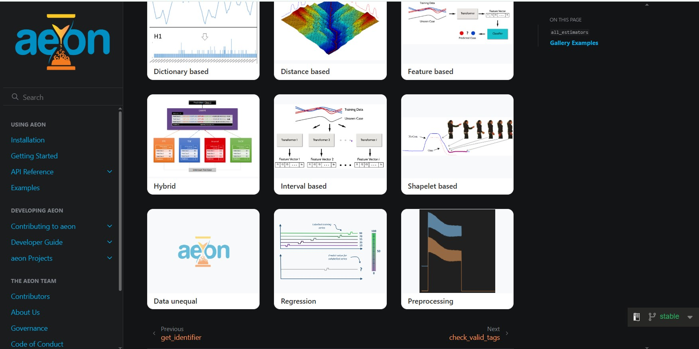

# Bringing Examples Galleries to Aeon's API Documentation with a Custom Sphinx Extension

## Introduction

While exploring open issues in `Aeon`, I came across an interesting issue about improving the API documentation.

The issue was inspired by `Scikit-learn`, which provides a collection of relevant examples below the API documentation of its estimators. For example, if you visit the documentation for `LogisticRegression`, you can find examples demonstrating how to use it in practice.

I really liked this idea and thought it would be a valuable addition to Aeon's documentation as well. So I decided to explore the issue and see how it could be implemented.

The requirement was straightforward: when someone visits the API documentation for an Aeon class or function, they should also be able to find relevant example notebooks that demonstrate its usage.

However, implementing this was not as straightforward as it initially seemed.

The main challenge was connecting Aeon's existing Jupyter notebook examples with its API reference pages without changing the existing documentation workflow.

I started exploring the available approaches, experimented with a few alternatives, and eventually decided to build a custom Sphinx extension to solve the problem.

Here's how I approached it.

## 1. Understanding the problem

Aeon already had a collection of example notebooks covering different topics, including classification, regression, clustering, transformations, and other time-series machine-learning tasks.

These examples were available in the documentation, but they were not directly connected to the API objects they demonstrated.

For example, imagine someone visits the API documentation for:

`aeon.classification.interval_based.TimeSeriesForestClassifier`

They might want to see a notebook demonstrating how to use this classifier.

Ideally, the API page would automatically display a small gallery containing relevant examples.

This would make it easier for users to move between API documentation and practical examples without having to search through the entire examples section.

The challenge was figuring out how to establish this connection automatically.

I wanted a solution that would:

- Work with the existing Jupyter notebooks.
- Identify which Aeon classes and functions are used in each notebook.
- Associate notebooks with the correct API objects.
- Display the existing example thumbnails.
- Link directly to the rendered notebook pages.

Most importantly, I wanted to avoid introducing unnecessary changes to the existing documentation workflow.

## 2. Exploring possible approaches

Before implementing anything, I looked into how this could be achieved using the existing documentation tooling.

One of the first options was [Sphinx-Gallery](https://sphinx-gallery.github.io/).

`Sphinx-Gallery` provides example galleries and backreferences that can connect examples with the API objects they use. It seemed like a natural fit for this requirement.

However, there was an important difference between what Sphinx-Gallery expects and what Aeon already had.

Sphinx-Gallery primarily works with Python scripts (`.py`), whereas Aeon's examples were maintained as Jupyter notebooks (`.ipynb`).

This meant that adopting it would require some changes to the existing workflow.

### Trying notebook-to-script conversion

I explored converting the existing notebooks into Python scripts using both `nbconvert` and `jupytext`.

For example, a notebook could be converted using:

```bash
jupyter nbconvert --to script my-notebook.ipynb
```

At first, this seemed like a straightforward solution.

However, I encountered a few practical problems.

**1. Notebook content and structure**

Converting notebooks into scripts did not always produce a complete representation of the original notebooks.

Some notebook-specific content, including embedded images, Markdown structure, and links between notebooks, was not preserved in the same way.

**2. Executing examples during documentation builds**

Another concern was that Sphinx-Gallery normally executes example scripts to generate their outputs.

Some Aeon examples involve computationally expensive models, including deep-learning classifiers. Executing all these examples during documentation builds could significantly increase build time and introduce additional environment requirements, such as GPU support.

**3. Integrating existing notebook pages**

I also investigated a hybrid approach: converting notebooks into scripts for Sphinx-Gallery's object-to-example matching while continuing to use Aeon's existing rendered notebook pages.

However, Sphinx-Gallery's backreference mechanism is closely connected to its own generated example pages. Connecting those backreferences cleanly to Aeon's existing HTML pages introduced additional complications.

After exploring these options, I felt that introducing a separate conversion and execution workflow just to generate API example links was unnecessarily complicated.

I wanted to keep the existing notebooks as they were.

That led me to another approach: building a small custom Sphinx extension.

## 3. The approach: A custom Sphinx extension

Instead of modifying the existing notebooks or introducing another example-generation pipeline, I decided to use Python's `Abstract Syntax Tree (AST)` module to inspect the notebooks.

The idea was to analyze the code inside each notebook, identify the Aeon objects referenced in that code, and build a mapping between those objects and their corresponding notebooks.

I also needed a way to associate each notebook with its existing thumbnail.

Finally, a custom Sphinx directive would use these mappings to generate the gallery on the API documentation pages.


The extension handles three main things:

1. Scanning notebooks and identifying Aeon object usage.
2. Building a mapping between notebooks and their thumbnails.
3. Rendering the mini-gallery on API reference pages.

Let's look at each part.

## 4. Scanning notebooks using Python AST

This is probably the most interesting part of the implementation.

Python provides the built-in `ast` module, which allows us to examine the structure of Python code without executing it.

For example, consider this code:

```python
from aeon.classification.interval_based import (
    TimeSeriesForestClassifier
)

classifier = TimeSeriesForestClassifier()
classifier.fit(X_train, y_train)
```

When Python parses this code using AST, it produces a tree representing its structure.

Instead of executing the notebook, I use an `ast.NodeVisitor` to walk through that tree and inspect different types of nodes.

I implemented a visitor called `AeonUsageVisitor`.

```python
class AeonUsageVisitor(ast.NodeVisitor):

    def __init__(self):
        self.symbol_table = {}
        self.module_aliases = {}
        self.used_objects = set()
```

The visitor maintains three data structures.

- `symbol_table`: Keeps track of imported Aeon objects and their fully qualified names.
- `module_aliases`: Tracks aliases used when importing Aeon modules.
- `used_objects`: Stores the Aeon objects identified during code analysis.

### Tracking imports

The first step is understanding which Aeon objects are imported.

For example:

```python
from aeon.classification.interval_based import (
    TimeSeriesForestClassifier as TSF
)
```

Here, the imported class is given the local name `TSF`.

If I only looked at the local name, I would lose the information about where the class originally came from.

To avoid that, I maintain a mapping between the alias and the fully qualified name.

After processing the import, the symbol table contains:

```python
{
    "TSF": (
        "aeon.classification.interval_based."
        "TimeSeriesForestClassifier"
    )
}
```

This also handles ordinary imports without aliases.

For module imports, I implemented similar tracking through `visit_Import`.

### Detecting object usage

Once imports are tracked, the visitor examines function calls, attribute access, and name references.

For example:

```python
classifier = TSF()
classifier.fit(X_train, y_train)
```

The `visit_Call` method examines function and constructor calls:

```python
def visit_Call(self, node):
    fq_name = self._resolve(node.func)

    if fq_name:
        self.used_objects.add(fq_name)

    self.generic_visit(node)
```

The `_resolve()` method determines whether an AST node refers to an imported Aeon object or an attribute belonging to an imported Aeon module.

This is also where alias resolution becomes useful.

For example, both of the following imports can be resolved to their original Aeon names:

```python
from aeon.classification.interval_based import (
    TimeSeriesForestClassifier as TSF
)

import aeon.classification.interval_based as interval
```

The visitor also implements `visit_Attribute` and `visit_Name` to capture relevant references.

The important point is that the notebook is inspected structurally. It is not executed to discover which objects it uses.

### Scanning all notebooks

With the visitor implemented, the next step is to scan the examples directory.

I used `nbformat` to read the notebooks and process their code cells.

Each code cell is parsed independently, and the visitor examines its AST.

Once a notebook has been processed, its relative path is associated with every detected Aeon object.


For example, the resulting mapping could conceptually look like this:

```python
{
    "aeon.classification.interval_based.TimeSeriesForestClassifier": [
        "classification/interval_based/time_series_forest"
    ],
    "aeon.classification.distance_based.KNeighborsTimeSeriesClassifier": [
        "classification/distance_based/knn"
    ]
}
```

These are illustrative mapping entries, showing the structure rather than actual output from a particular build.

The result is a mapping between fully qualified Aeon objects and the notebooks in which they are referenced.

## 5. Building the thumbnail mapping

Identifying the relevant notebooks was only one part of the problem.

I also needed to know which thumbnail should be displayed for each example.

Aeon already had an `examples.md` file containing curated example entries and their associated images.

Rather than trying to infer thumbnail filenames or generate new images, I decided to reuse that existing information.

I implemented a second mapping by parsing `examples.md`.

The relevant part uses a regular expression:

```python
pattern = re.compile(
    r":img-top:\s*(?P.+?)\s+.*?"
    r":link:\s*/examples/(?P<nb>.+?)\.ipynb",
    re.DOTALL,
)
```

This extracts two things:

- The image associated with an example.
- The notebook path linked to that example.

The resulting structure looks like:

```python
{
    "classification/interval_based/time_series_forest": (
        "path/to/time_series_forest.png"
    ),
    "classification/distance_based/knn": (
        "path/to/knn.png"
    )
}
```

Again, these are illustrative entries.

This separation was intentional.

The AST analysis determines which examples are relevant to an API object, while `examples.md` determines which image belongs to each example.

Neither process needs to know the internal details of the other.

## 6. Connecting everything through the Sphinx environment

At this point, I had two mappings:

```python
aeon_example_map
aeon_thumbnail_map
```

The next step was making them available when Sphinx generates the API documentation pages.

Sphinx provides an environment object that can be accessed through the application.

I stored both mappings there:

```python
app.env.aeon_example_map = mapping
app.env.aeon_thumbnail_map = thumbnail_map
```

Both scanning functions are connected to the `builder-inited` event.

This means that when the Sphinx builder is initialized, the two mappings are prepared and stored in the environment.

The directive can then access them when API pages are processed.

There is no need to repeat the notebook analysis for every API page.

## 7. Creating a custom Sphinx directive

Now comes the part that connects the implementation to the actual API documentation.

I created a custom directive named `aeon-mini-gallery`.

Its responsibility is straightforward:

1. Receive the fully qualified API object name.
2. Find the notebooks associated with that object.
3. Find the corresponding thumbnails.
4. Generate gallery cards linking to the rendered notebook pages.

Using fully qualified names is important.

Two different Aeon modules could potentially contain objects with the same short name. Matching only by something like `Classifier` would not reliably distinguish them.

By passing the module and object name together, the directive can perform an exact lookup.

### Generating gallery cards

For every matching notebook, the directive retrieves its thumbnail and generates the corresponding links.

The example page URL is calculated using Sphinx's builder:

```python
example_doc = f"examples/{ex}"

example_uri = builder.get_relative_uri(
    env.docname,
    example_doc,
)
```

The thumbnail path is also made relative to the current API page:

```python
thumb_uri = relative_uri(
    page_uri,
    f"_images/{Path(thumb_path).name}",
)
```

Finally, the card is generated as HTML:

```python
cards.append(f"""
    <a class="aeon-mini-card" href="{example_uri}">
        <div class="aeon-mini-image">
            
        </div>
        <div class="aeon-mini-title">
            {card_title}
        </div>
    </a>
""")
```

Each card contains a thumbnail, a title derived from the notebook filename, and a link to the rendered example page.


## 8. Integrating the directive into API templates

The final step was connecting the directive to Aeon's existing API reference templates.

I added it to both the class and function templates.

In `docs/_templates/class.rst`:

```rst
.. aeon-mini-gallery:: {{ module }}.{{ objname }}
```

And in `docs/_templates/function.rst`:

```rst
.. aeon-mini-gallery:: {{ module }}.{{ objname }}
```

This allows the gallery to be generated automatically for both classes and functions.

There is no need to manually add example links to individual API pages.

Whenever Sphinx processes one of these templates, it passes the fully qualified object name to the custom directive.

The directive takes care of finding the relevant examples.

## 9. Styling the gallery

For the visual presentation, I added a separate CSS file:

```text
docs/_static/css/aeon_gallery.css
```

The gallery uses CSS Grid to arrange the example cards into three columns.

Each card has a thumbnail area and a title section.

## 10. What the final result looks like

The result is that Aeon's API reference pages can now display example notebooks that are associated with the documented class or function.

Instead of navigating separately to the examples section and searching for a relevant notebook, users can discover those examples directly from the API page.



*The mini-gallery displayed on an Aeon API reference page.*

## 11. Getting the implementation reviewed and merged

I also had some useful discussions with the Aeon maintainers during the pull request.

One of the main questions was whether introducing a custom Sphinx extension was justified, considering the additional maintenance it might introduce.

The suggestion was to investigate converting the notebooks into Python scripts and using Sphinx-Gallery instead.

I explored that alternative and explained the practical problems I encountered with notebook conversion, example execution, and integrating the generated backreferences with the existing HTML pages.

After discussing these trade-offs, the maintainers agreed that the custom extension was a reasonable solution.

There were also some implementation-level review comments.

One important suggestion was to use fully qualified object names rather than short names when matching examples. This avoids ambiguity when different modules contain objects with identical names.

Another suggestion was to avoid displaying an empty gallery heading when matching notebooks did not have corresponding thumbnail entries.

These discussions helped improve the implementation.

Eventually, the pull request was merged into Aeon.

**Pull request:** [https://github.com/aeon-toolkit/aeon/pull/3334](https://github.com/aeon-toolkit/aeon/pull/3334)

**Related issue:** [https://github.com/aeon-toolkit/aeon/issues/164](https://github.com/aeon-toolkit/aeon/issues/164)
